# Same Agent, Two Telemetry Dictionaries: Reading OpenTelemetry GenAI and OpenInference Side by Side

*What changes (and what stays identical) when you trace the exact same AI agent in Google ADK and LangGraph, locally and on Google Cloud Agent Runtime.*

**By Dani Zamora** · Solutions Engineer, Google Cloud

> **Part of [Advent of Agents](https://adventofagents.com/) · Season 3 (Agent Governance & Security) · Day 22**
>
> **If you are reading this before the Day 22 video goes live:** this article stands on its own. We build one small trip-concierge agent twice (once in Google ADK, once in LangGraph), inspect its raw OpenTelemetry traces line by line, and demystify why two open telemetry dictionaries exist today. When the Day 22 episode airs on [adventofagents.com](https://adventofagents.com/), you will see how we take these exact traces into Cloud Logging and BigQuery to answer the governance question: *"Can I get an immutable audit trail and latency trace of every tool call and model decision?"*
>
> **If you arrived here from the Day 22 episode:** welcome! Below is the complete line-by-line walkthrough of the two telemetry dictionaries, the interactive comparison app, the model provider experiments (Gemini 3.8 Flash vs Claude Sonnet 5.5), and the 15-line Python span processor that makes LangGraph sessions light up in the Agent Platform console.
>
> **Code & interactive app:** [`github.com/danielazamorah/agent-telemetry-side-by-side`](https://github.com/danielazamorah/agent-telemetry-side-by-side)

---

## 1. The Moment I Got Confused

While preparing for Day 22 of Advent of Agents, I put two agents side by side, opened their OpenTelemetry traces, and stopped cold.

Both agents ran the exact same prompt against the exact same model (`gemini-3.8-flash`). Both exported standard OpenTelemetry spans. Yet one trace recorded input tokens under `gen_ai.usage.input_tokens`, while the other recorded them under `llm.token_count.prompt`. One reported `168` output tokens; the other reported `34`. One kept the user's prompt off the span completely; the other embedded the full message array right inside `input.value`.

Are those competing standards? Do you have to pick one framework to get the right telemetry? And what happens downstream when your observability dashboard, evaluation pipeline, or security scanner tries to read both?

Whenever I get confused by an infrastructure question, I do the same thing: build the smallest possible reproducible example and read the raw output line by line. Everything in this article comes from that experiment, and you can run all of it yourself from [`danielazamorah/agent-telemetry-side-by-side`](https://github.com/danielazamorah/agent-telemetry-side-by-side).

---

## 2. One Agent, Three Tools, Two Questions

To make the comparison fair, both agents share the exact same plain-Python tools (`tools.py`), system instructions, and questions:

1. **`get_weather(city)`**: sleeps `0.7s` and returns a weekend forecast.
2. **`get_events(city)`**: sleeps `0.9s` and returns weekend events with ticket prices in EUR.
3. **`convert_currency(amount, from_currency, to_currency)`**: sleeps `0.5s` and converts between EUR and USD.

The tools are `async` and sleep for fixed durations so that parallel versus serial tool execution is immediately visible in a trace waterfall:

* **The parallel question:** *"I'm flying to Lisbon this weekend. What's the weather, and what's on?"* (Two independent tools: `get_weather` and `get_events` can run at the same time.)
* **The serial question:** *"How much is the Fado night in Lisbon in US dollars?"* (The model must call `get_events` first to learn the Fado ticket costs 35 EUR, then call `convert_currency`.)

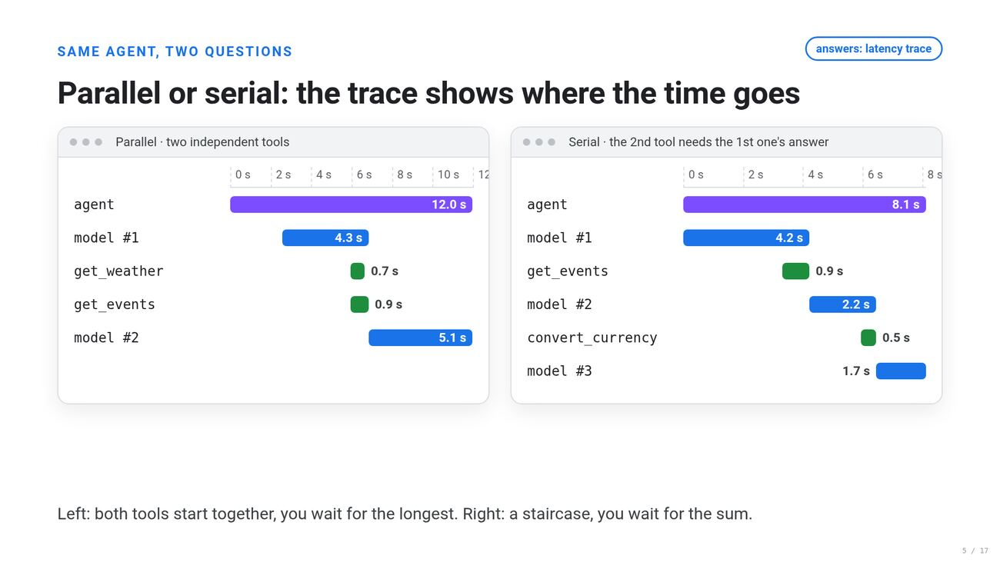
*Same agent, two questions: parallel tool calls start together; serial tool calls form a staircase.*


---

## 3. Here Is the ADK Agent and Its Telemetry

First, here is the agent written with the **Google Agent Development Kit (ADK)** (`adk_agent/agent.py`):

```python
from google.adk.agents import LlmAgent
from tools import INSTRUCTION, convert_currency, get_events, get_weather

root_agent = LlmAgent(
    name="trip_concierge",
    model="gemini-3.8-flash",
    instruction=INSTRUCTION,
    tools=[get_weather, get_events, convert_currency],
)
```

ADK has OpenTelemetry built in. Without adding a single line of tracing code, running `adk web .` and asking the Lisbon question shows the model requesting both tool calls in a single step:

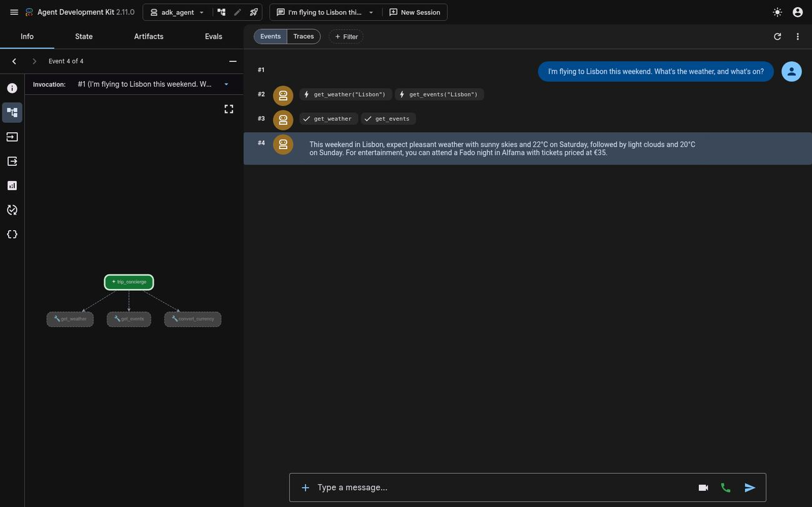
*ADK web: the model requests get_weather and get_events in the same step.*


Switching to the **Traces** tab in `adk web` shows the waterfall: `invocation` wraps `invoke_agent trip_concierge`, which calls the model (`call_llm` -> `generate_content gemini-3.8-flash`), runs `execute_tool get_weather` and `execute_tool get_events` in parallel, and calls the model a second time to write the final answer:

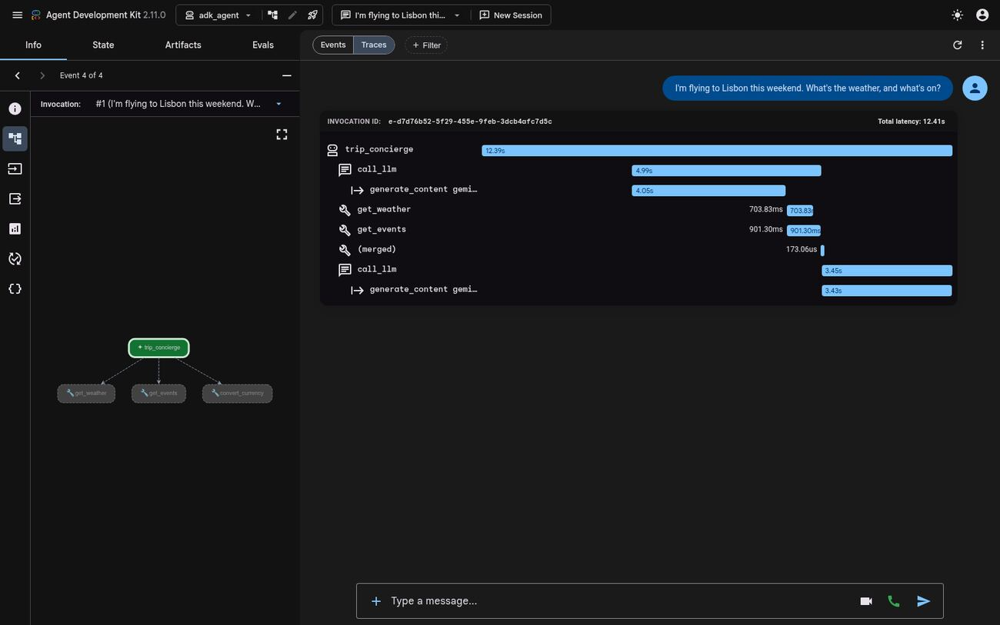
*ADK web Traces view: one trace per request, with the two tool spans overlapping in time.*


When we click the first `generate_content gemini-3.8-flash` span and open its raw JSON (`{}` tab), we see the **OpenTelemetry GenAI semantic conventions** (`gen_ai.*`):

```json
{
  "gen_ai.operation.name": "generate_content",
  "gen_ai.request.model": "gemini-3.8-flash",
  "gen_ai.conversation.id": "05d81804-2739-48e3-9dd4-a68992d7263b",
  "gen_ai.usage.input_tokens": 276,
  "gen_ai.usage.output_tokens": 168,
  "gen_ai.usage.reasoning.output_tokens": 134
}
```

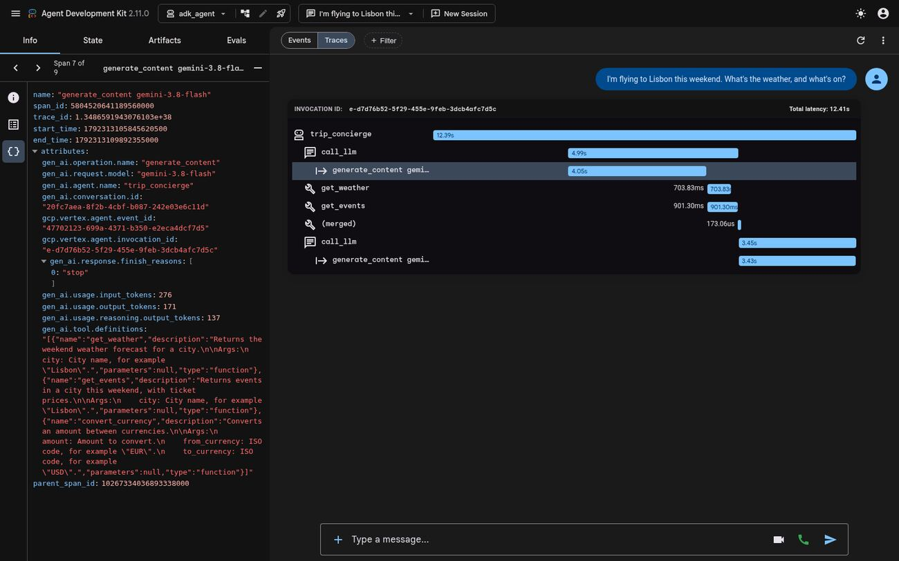
*ADK web raw span JSON: gen_ai.* attributes with token counts and model metadata, but no prompt text on the span.*


Notice two things right away:
1. Every attribute uses the `gen_ai.*` namespace (`gen_ai.operation.name`, `gen_ai.request.model`, `gen_ai.usage.*`, `gen_ai.conversation.id`).
2. **There are numbers, but no words.** By default, the user's prompt and the model's response are not stored on the span.

---

## 4. The Exact Same Agent in LangGraph

Next, here is the exact same agent written with **LangGraph** (`langgraph_agent.py`):

```python
from langchain_core.tools import tool
from langchain_google_vertexai import ChatVertexAI
from langgraph.checkpoint.memory import InMemorySaver
from langgraph.prebuilt import create_react_agent
from tools import INSTRUCTION, convert_currency, get_events, get_weather

llm = ChatVertexAI(model_name="gemini-3.8-flash", location="global", temperature=0)
agent = create_react_agent(
    llm,
    [tool(get_weather), tool(get_events), tool(convert_currency)],
    prompt=INSTRUCTION,
    checkpointer=InMemorySaver(),
)
```

LangGraph does not emit OpenTelemetry spans on its own. To trace it, you add an OpenTelemetry instrumentor. The most widely used one in the Python ecosystem (and the one Google Cloud Agent Runtime's `LanggraphAgent(enable_tracing=True)` template turns on automatically) is `openinference-instrumentation-langchain`.

Running `python capture.py adk` and `python capture.py langgraph` saves both traces as plain JSON files (`traces/adk__parallel.json` and `traces/langgraph__parallel.json`) and embeds them into a single-file browser app (`app/index.html`) where you can also drag and drop your own trace exports.

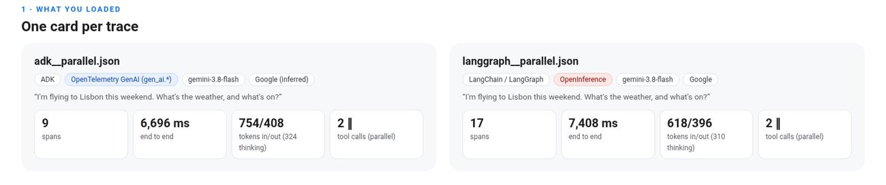
*The trace comparison app: one summary card per trace (ADK native on the left, LangGraph + OpenInference on the right).*


Both traces tell the exact same runtime story: the model decides to call two tools, both tools run in parallel, and the model answers. The structural difference is that ADK writes **9 spans** while LangGraph writes **17 spans**, because LangChain/LangGraph wraps every graph node (`agent`, `call_model`, `RunnableSequence`, `Prompt`, `should_continue`, `tools`) in its own span:

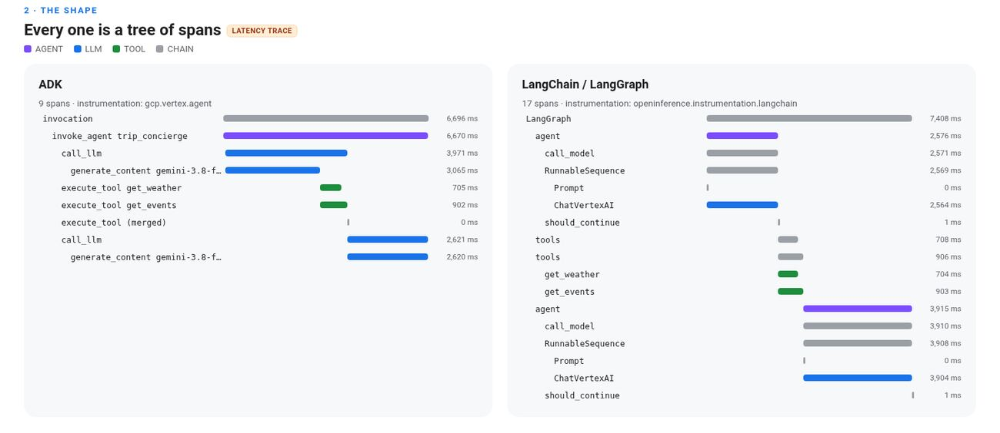
*Both frameworks produce a standard OpenTelemetry span tree: ids, parent_span_id, and timestamps work the same way.*


And if we read the model and tool spans in chronological order, both frameworks give us the complete audit trail of every model decision and every tool call:

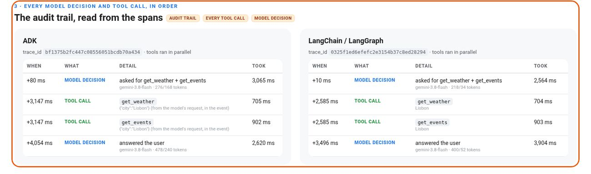
*Reading the spans in order yields the same audit trail of model decisions and tool executions across both frameworks.*


---

## 5. Same Facts, Two Dictionaries

When we open the first model call span from each trace side by side and highlight identical facts in the same color, the mystery disappears:

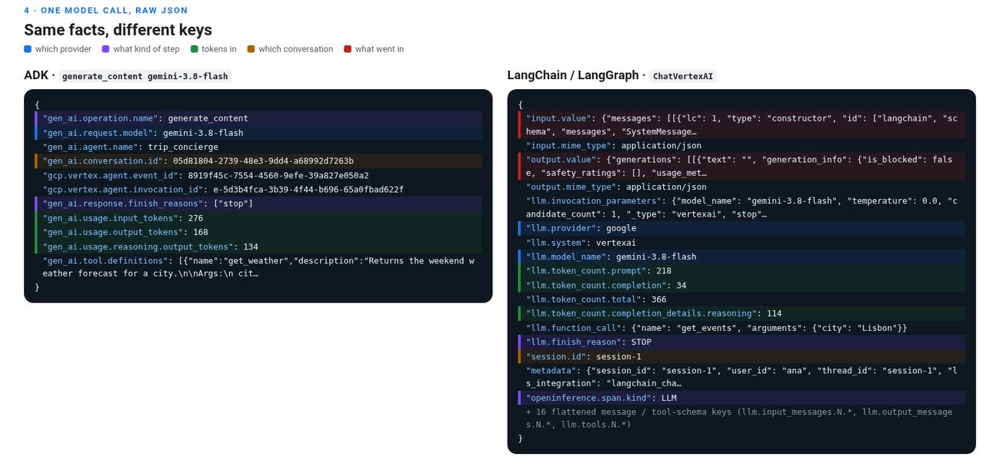
*One model call as raw JSON: purple = step kind, blue = model name, green = token counts, orange = conversation ID.*


Both frameworks use OpenTelemetry (the open standard for traces, logs, and metrics), so the envelope (`trace_id`, `span_id`, `parent_span_id`, `start_time`, `end_time`) is identical. What differs is the **semantic convention** (the dictionary of attribute names inside `attributes`):

| Fact | ADK (`gen_ai.*` · OpenTelemetry GenAI) | LangGraph (`openinference.*` / `llm.*` · OpenInference) |
| :-- | :-- | :-- |
| **What kind of step** | `gen_ai.operation.name` = `"generate_content"` | `openinference.span.kind` = `"LLM"` |
| **Which model** | `gen_ai.request.model` = `"gemini-3.8-flash"` | `llm.model_name` = `"gemini-3.8-flash"` |
| **Input tokens** | `gen_ai.usage.input_tokens` = `276` | `llm.token_count.prompt` = `218` |
| **Output tokens** | `gen_ai.usage.output_tokens` = `168` *(includes thinking)* | `llm.token_count.completion` = `34` *(visible answer only)* |
| **Thinking tokens** | `gen_ai.usage.reasoning.output_tokens` = `134` | `llm.token_count.completion_details.reasoning` = `114` |
| **Conversation ID** | `gen_ai.conversation.id` | `session.id` |
| **Where the words live** | Separate log event (`gen_ai.input.messages` / `output.messages`), opt-in | On the span (`input.value` / `output.value`), on by default |

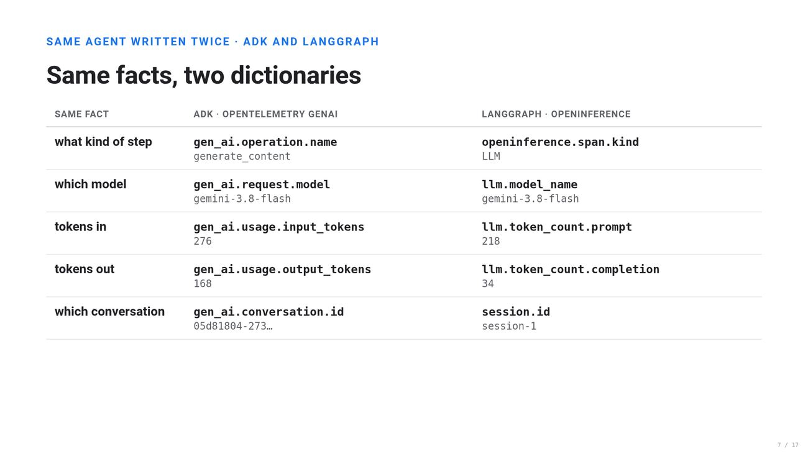
*Rosetta table: the same runtime facts expressed in OpenTelemetry GenAI versus OpenInference.*


---

## 6. Where the Words Go (and Why Spans Stay Clean)

The biggest architectural difference between the two dictionaries is where they put the conversation text (the user prompt, system instructions, tool results, and model answer):

* **OpenTelemetry GenAI (`gen_ai.*`, used by ADK) is privacy-first and size-safe.** The span carries only metadata and token counts. If you opt in with `OTEL_INSTRUMENTATION_GENAI_CAPTURE_MESSAGE_CONTENT=EVENT_ONLY`, the instrumentation writes the prompt and response to a separate OpenTelemetry **LogRecord** (`gen_ai.client.inference.operation.details`) stamped with the exact `trace_id` and `span_id` of the model span.
  * *Why separate them?* Two practical reasons: first, you often want engineers inspecting latency waterfalls in Cloud Trace without exposing customer PII in prompts. Second, **Cloud Trace enforces byte limits on span attribute values** (truncating long strings), whereas Cloud Logging (or offloading large multimodal payloads to Cloud Storage via `OTEL_INSTRUMENTATION_GENAI_COMPLETION_HOOK=upload`) is built for full transcripts.
  * **Mental model:** *The span is the receipt, the log is the transcript, and the trace ID is the staple.*
* **OpenInference (used by the LangChain/LangGraph instrumentor) puts everything in one place.** By default, it serializes the full input and output messages directly onto the span under `input.value`, `output.value`, and `llm.input_messages.*` (which you can redact or disable via `TraceConfig` privacy settings before exporting).

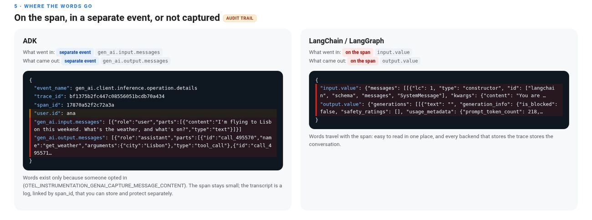
*Where the words go: an opt-in correlated log event in OpenTelemetry GenAI versus span attributes in OpenInference.*


---

## 7. The Output-Token Trap: 168 vs 34

Look closely at the output token numbers on the first model call for the exact same Lisbon question on `gemini-3.8-flash`:

* **ADK (`gen_ai.usage.output_tokens`) reports `168`.**
* **LangGraph (`llm.token_count.completion`) reports `34`.**

Did LangGraph use five times fewer output tokens? No! Both calls generated the exact same two tool calls (`34` visible completion tokens). The difference is semantic:

* In the Google GenAI / ADK instrumentation, `gen_ai.usage.output_tokens` (`168`) **includes the model's thinking tokens** (`134`, reported in `gen_ai.usage.reasoning.output_tokens`), matching how thinking tokens are billed as output.
* In `openinference-instrumentation-langchain`, `llm.token_count.completion` (`34`) reports **only the visible completion tokens**, while the `114` thinking tokens live separately in `llm.token_count.completion_details.reasoning` (and `llm.token_count.total = 349 = 218 + 34 + 114` sums all three).

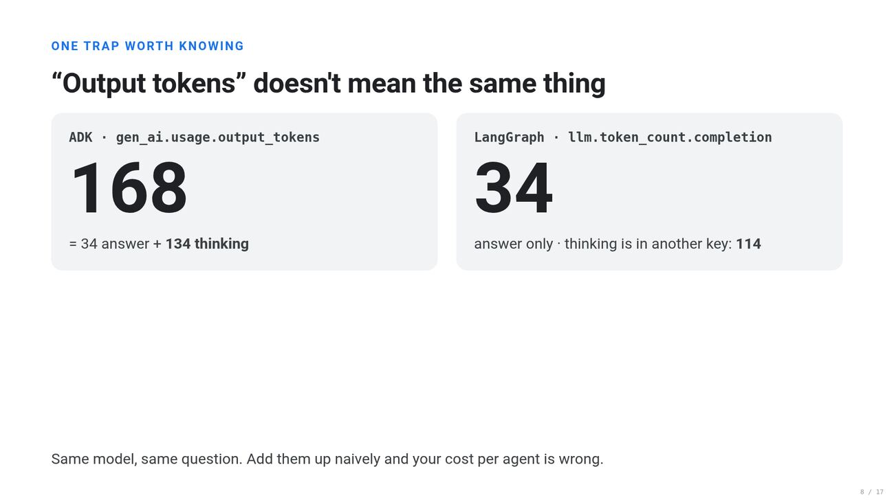
*The output-token trap: gen_ai.usage.output_tokens includes thinking tokens; llm.token_count.completion does not.*


If you build a cost or token burn-rate dashboard across agents and sum `output_tokens` and `completion` without normalizing for thinking tokens, your numbers per agent will be completely skewed.

---

## 8. Two More Experiments: Swapping the Model Provider vs Swapping the Instrumentor

### Experiment A: Same harness, different model (`gemini-3.8-flash` vs `claude-sonnet-5-5`)

What happens if we keep the agent framework fixed and swap the model provider to **Claude Sonnet 5.5** on Vertex AI (`python capture.py adk --model claude-sonnet-5-5`)?

The span tree and the telemetry dictionary **stay 100% identical**, because the harness and its instrumentor write the spans, not the model provider. What changes are the values inside:
* **Token counts jump ~3x on the first call** (`276` -> `851` input tokens in ADK; `218` -> `755` in LangGraph) because each provider formats tool schemas and tokenizes text differently. Compare **cost**, not raw token counts, across providers.
* **ADK does not set a model provider attribute** (`gen_ai.system` is always `"gcp.vertex.agent"`), so group multi-provider spend by `gen_ai.request.model`.
* **In LangGraph, finish reasons change dialect:** Gemini reports `"STOP"`, while Claude reports `"tool_use"`.

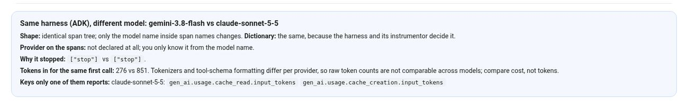
*Same harness (ADK), different model (Gemini 3.8 Flash vs Claude Sonnet 5.5 on Vertex AI).*


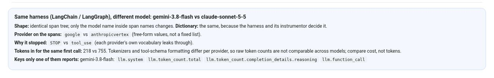
*Same harness (LangGraph), different model: finish_reason shifts from STOP to tool_use.*


### Experiment B: Same framework, other dictionary (`ADK + GoogleADKInstrumentor`)

What if we keep the ADK agent, and attach Arize's `openinference-instrumentation-google-adk` (`python capture.py adk-openinference`)?

Now the **ADK agent** emits `openinference.span.kind`, `llm.model_name`, `input.value`, and `session.id`. **The framework does not pick the dictionary; the instrumentor does.**

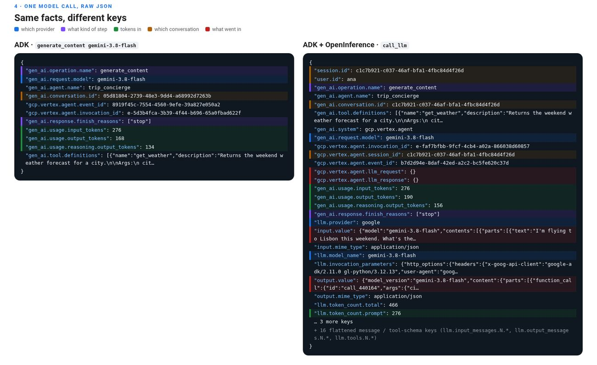
*The same ADK agent instrumented with GoogleADKInstrumentor now speaks OpenInference.*


---

## 9. Traces vs Session Data

Another common point of confusion is the difference between **traces** and **session data**:

* **A trace (telemetry)** records *how a single request executed*: spans, start and end timestamps, latency waterfalls, token counts, and tool calls. It is written by OpenTelemetry for observability and evaluation tools.
* **A session (application state)** records *the conversation history across turns*: user messages, tool calls, tool responses, and agent state so the agent has memory on turn 2. It is written by the framework (`SessionService` in ADK, a `checkpointer` in LangGraph) for the agent itself.

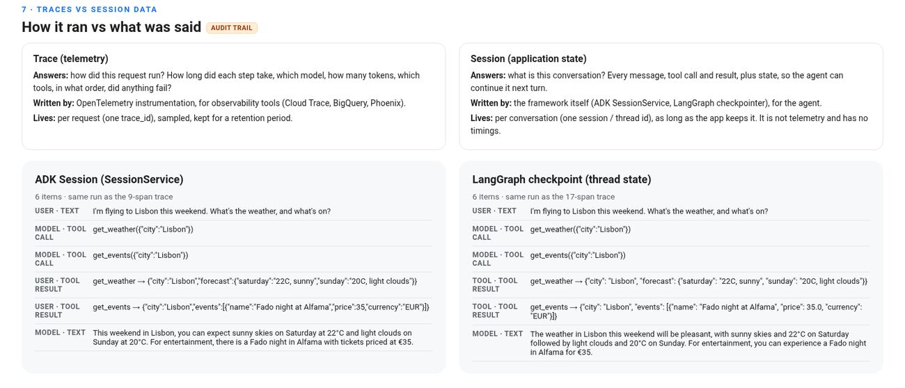
*Traces vs session data for the exact same run: even here, ADK records tool responses with role 'user' while LangGraph uses role 'tool'.*


---

## 10. Deployed on Google Cloud Agent Runtime: Why the Console Reads One Dictionary (and How to Bridge It)

Does this dictionary split actually affect you in the Google Cloud console? Let's look at what happens when we deploy both agents to **Vertex AI Agent Runtime** (`agent-platform/runtimes`):

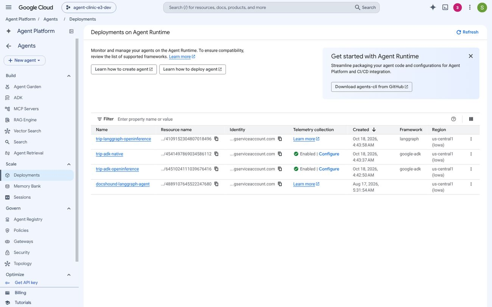
*Agent Platform › Scale › Deployments: the console tracks the Framework column (google-adk vs langgraph) for each deployed agent.*


When we open `trip-adk-native` and click **Traces › Session view**, the console lists every multi-turn conversation alongside its duration, average latency, agent invocations, model calls, tool calls, and total token usage:

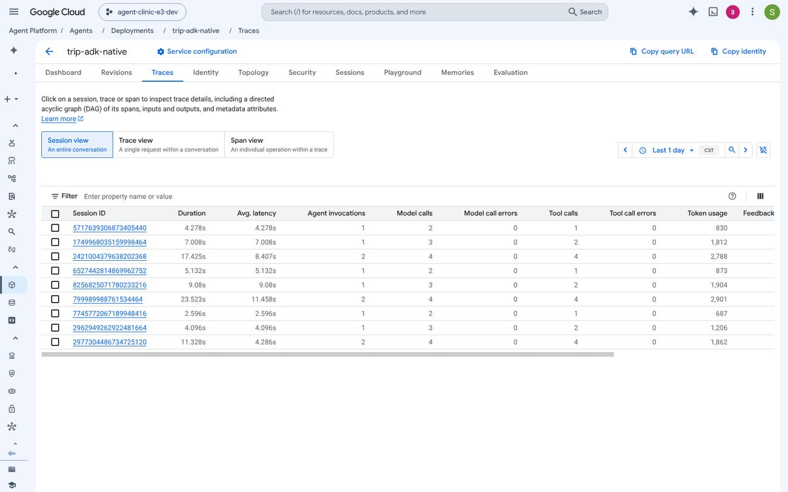
*ADK agent on Agent Runtime: Traces › Session view groups multi-turn conversations and totals model calls, tool calls, and tokens.*


Now we open `trip-langgraph-openinference` (deployed with the official `LanggraphAgent(..., enable_tracing=True)` template) and click **Traces › Session view**:

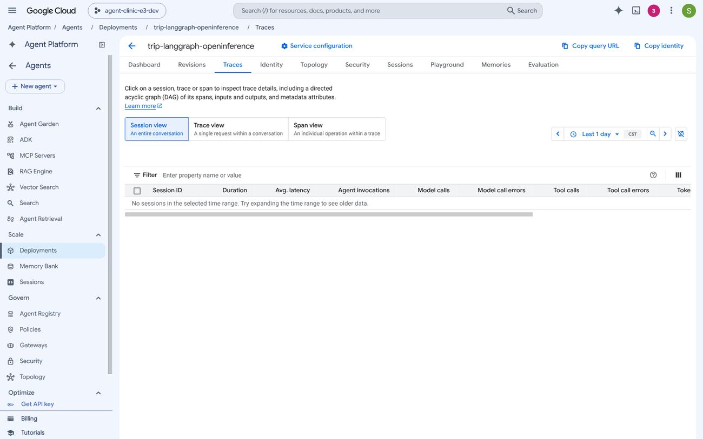
*LangGraph agent on Agent Runtime (out of the box): Session view says 'No sessions in the selected time range' even though Trace view has all 12 traces.*


And if we open one of its traces and look at the **Conversation** tab:

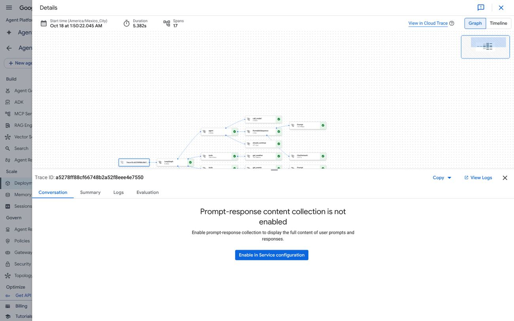
*LangGraph trace Conversation tab: 'Prompt-response content collection is not enabled', even though input.value and output.value are right on the ChatVertexAI span.*


Why did that happen? Neither agent is broken:
1. The Agent Platform **Session view** groups traces by `gen_ai.conversation.id`, counts root invocations where `gen_ai.operation.name IN ('invoke_agent', 'invoke_workflow')`, and sums `gen_ai.usage.input_tokens + gen_ai.usage.output_tokens` on `gen_ai.operation.name = 'generate_content'` spans. Out of the box, `LanggraphAgent` uses OpenInference, which writes `session.id` and `llm.token_count.*` instead.
2. The **Conversation** tab checks for the GenAI content env var (`OTEL_INSTRUMENTATION_GENAI_CAPTURE_MESSAGE_CONTENT`) and reads the GenAI log events, whereas OpenInference puts the words on the span in `input.value` and `output.value`.

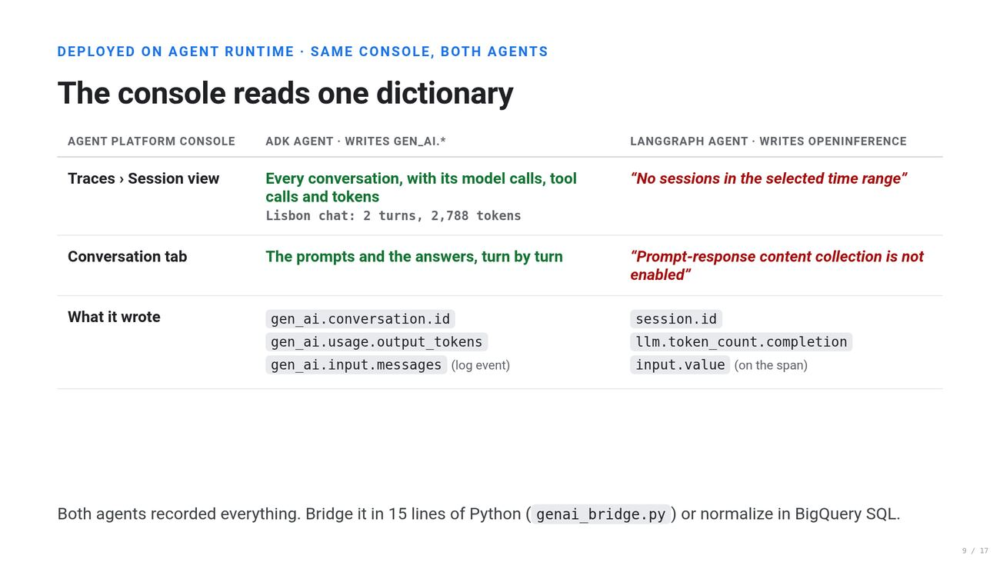
*Why the console behaves differently for the two agents out of the box.*


Once you understand the two dictionaries, you have **two clean ways to solve this**:

### Fix 1: Bridge it at the source in 15 lines of Python (`genai_bridge.py`)

Because both dictionaries sit on top of standard OpenTelemetry `SpanProcessor` pipelines, you can attach a tiny processor inside `LanggraphAgent`'s `model_builder` (after Agent Runtime's default exporter setup has initialized the `TracerProvider`) that keeps every OpenInference attribute intact while stamping the four `gen_ai.*` keys the Agent Platform console reads (`genai_bridge.py` in the repo):

```python
from opentelemetry.sdk.trace import SpanProcessor
from vertexai.agent_engines import LanggraphAgent

class GenAIBridgeSpanProcessor(SpanProcessor):
    def on_end(self, span) -> None:
        a = dict(span.attributes or {})
        if "session.id" in a and "gen_ai.conversation.id" not in a:
            a["gen_ai.conversation.id"] = str(a["session.id"])
        kind = a.get("openinference.span.kind")
        if (span.parent is None or span.name == "LangGraph") and "gen_ai.operation.name" not in a:
            a["gen_ai.operation.name"] = "invoke_agent"
            a.setdefault("gen_ai.agent.name", "trip_concierge_langgraph")
        elif kind == "LLM":
            a.setdefault("gen_ai.operation.name", "generate_content")
            prompt = int(a.get("llm.token_count.prompt") or 0)
            comp = int(a.get("llm.token_count.completion") or 0)
            reas = int(a.get("llm.token_count.completion_details.reasoning") or 0)
            a.setdefault("gen_ai.usage.input_tokens", prompt)
            a.setdefault("gen_ai.usage.output_tokens", comp + reas)
        elif kind == "TOOL":
            a.setdefault("gen_ai.operation.name", "execute_tool")
            a.setdefault("gen_ai.tool.name", str(a.get("tool.name") or span.name))
        span._attributes = a
```

Call `install_genai_bridge()` inside `model_builder`, and **Traces › Session view** in the Cloud console populates for your LangGraph agent (`trip-langgraph-bridged`) too!

Here is the same LangGraph agent, redeployed as `trip-langgraph-bridged` with the bridge turned on. Same framework, same instrumentor, same model; only the dictionary changed:

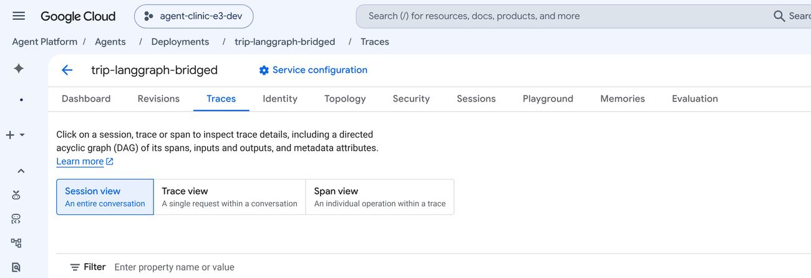
*Agent Platform: trip-langgraph-bridged, Traces › Session view. With the 15-line bridge, the same LangGraph agent now lists its sessions with model calls, tool calls, and token usage.*


### Fix 2: Normalize at rest in BigQuery (Zero-Copy Linked Dataset + SQL View)

In a real enterprise, you also have low-code agents, third-party agents, and existing deployments whose code you don't want to touch. Because Cloud Trace stores every span in the `_Trace` bucket, you can expose `_Trace._AllSpans` and `_Default._AllLogs` as zero-copy linked datasets in BigQuery and normalize both dictionaries in a single SQL `VIEW` using `COALESCE`:

```sql
COALESCE(
  JSON_VALUE(attributes, '$."gen_ai.request.model"'),
  JSON_VALUE(attributes, '$."llm.model_name"')
) AS model_name,
COALESCE(
  SAFE_CAST(JSON_VALUE(attributes, '$."gen_ai.usage.input_tokens"') AS INT64),
  SAFE_CAST(JSON_VALUE(attributes, '$."llm.token_count.prompt"') AS INT64)
) AS input_tokens
```

And for agents using `EVENT_ONLY` content logging, a single `JOIN USING (trace_id, span_id)` between the trace spans and the Cloud Logging events reunites the latency and token receipt from the span with the scrubbed prompt and response transcript from the log:

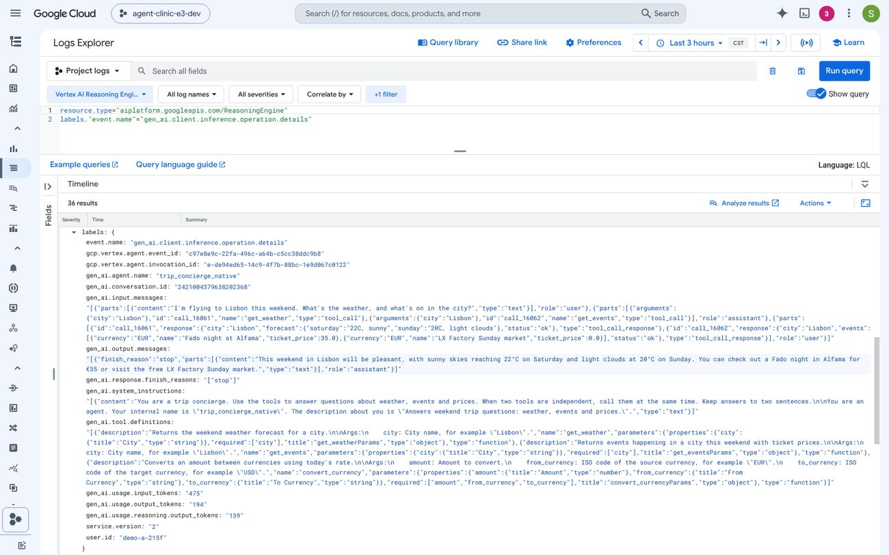
*Cloud Logging: one gen_ai.client.inference.operation.details log entry per model call, carrying trace_id, span_id, user.id, and the input/output messages.*


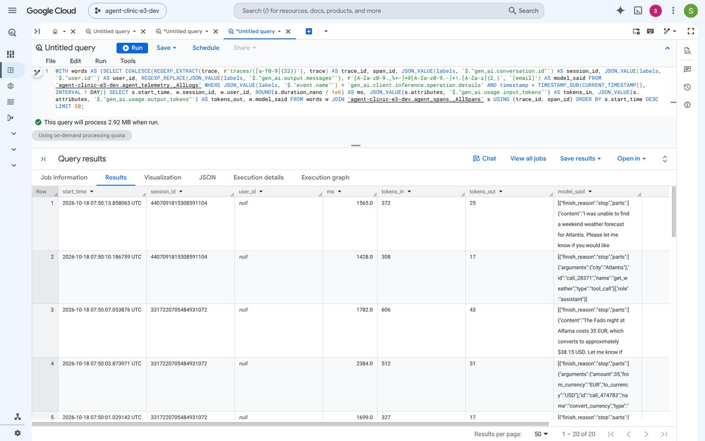
*BigQuery: joining _Trace._AllSpans to _Default._AllLogs on (trace_id, span_id) with email scrubbing.*


---

## 11. Why Two Dictionaries Exist (and How They Are Converging)

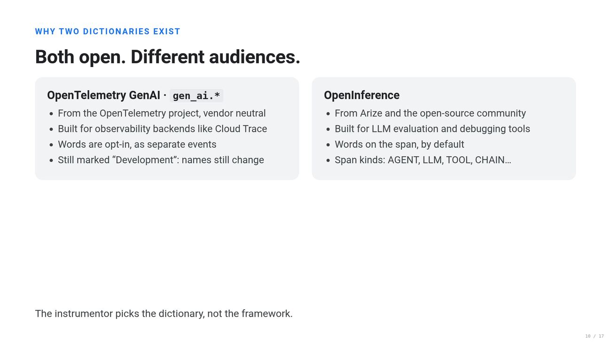
*Why two open dictionaries exist: OpenTelemetry GenAI for observability backends, OpenInference for LLM evaluation and debugging tools.*


* **OpenTelemetry GenAI (`gen_ai.*`)** comes from the OpenTelemetry GenAI Special Interest Group (SIG). It is designed for general-purpose observability backends (like Google Cloud Trace, Datadog, and Grafana), defaults to keeping sensitive prompt text off spans, and is still marked *Development* as the specification evolves.
* **OpenInference** comes from Arize AI and the open-source community. It is designed for AI evaluation and debugging tools (like Arize AX and Phoenix), provides rich semantic span kinds (`AGENT`, `LLM`, `TOOL`, `CHAIN`, `RETRIEVER`), and includes prompts and responses on spans by default so eval pipelines have everything in one record.

The best news is that Google Cloud and Arize are actively collaborating within the OpenTelemetry community to converge these standards. (Watch the Google Cloud Next breakout session [**Defining the standard: Google Cloud and Arize unify agent observability**](https://www.youtube.com/watch?v=nLH0IqHLxaA) with Google Cloud's Ameer Abbas and Rami Shalom alongside Arize CEO Jason Lopatecki.)

### What you should do today

1. **Try it on your own traces:** Clone [`danielazamorah/agent-telemetry-side-by-side`](https://github.com/danielazamorah/agent-telemetry-side-by-side), open `app/index.html`, and drop any trace JSON from your own agents to see which dictionary they speak.
2. **Bridge or normalize deliberately:** If you deploy LangGraph on Agent Runtime and want the console's Session view, drop in `genai_bridge.py`. If you aggregate multiple agent types for evaluation or audit, normalize them in a BigQuery SQL view.
3. **Follow Advent of Agents Season 3:** Head to [**adventofagents.com**](https://adventofagents.com/) for **Day 22** (where we take this further into PII scrubbing and immutable locked audit buckets) and watch our companion [**AI Agent Clinic episode**](https://www.youtube.com/watch?v=wPdoZRbvaF4) on how downstream evaluation pipelines consume these traces.
