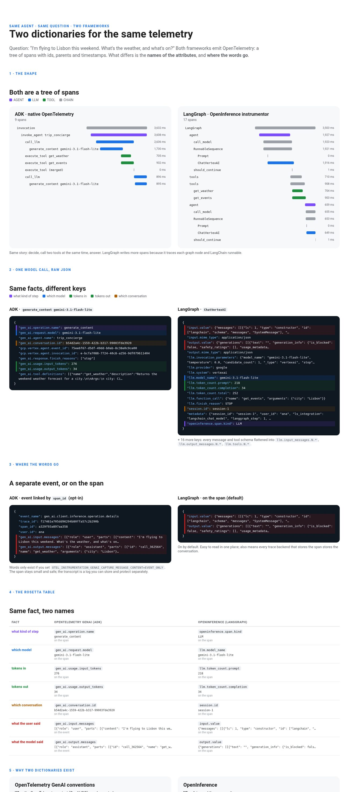

# Same agent, two telemetry dictionaries

One tiny trip-concierge agent, written twice (Google ADK and LangGraph), asked the same question. Both write OpenTelemetry. This repo saves what each one writes as plain JSON so you can put them side by side and see exactly what is the same and what is different.

**The answer in one line:** both produce the same tree of spans (ids, parents, timestamps). The differences are the **names of the attributes** (`gen_ai.*` vs `openinference.*` / `llm.*`) and **where the words go** (a separate, opt-in event vs on the span).



## Run it

```bash
python -m venv .venv && source .venv/bin/activate
pip install -r requirements.txt

export GOOGLE_GENAI_USE_VERTEXAI=TRUE
export GOOGLE_CLOUD_PROJECT=<your-project>
export GOOGLE_CLOUD_LOCATION=global        # Gemini 3.x is served from the global endpoint

python capture.py adk                      # ADK, built-in OpenTelemetry
python capture.py langgraph                # LangGraph + OpenInference instrumentor
python capture.py adk-openinference        # bonus: the same ADK agent, OpenInference instrumentor
python compare.py                          # prints the Rosetta table, writes viewer.html
```

Add `--question serial` to `capture.py` and `compare.py` for the question where the second tool needs the first one's answer.

Each run writes `traces/<agent>__<question>.json`: `spans` (name, ids, parent, start/end, duration, attributes) and `events` (OpenTelemetry log records). Nothing is sent anywhere except the model calls; the exporters write to memory.

| File | What it is |
| :-- | :-- |
| `tools.py` | the three tools both agents share (plain Python, no framework) |
| `adk_agent/agent.py` | the ADK agent (also runs in `adk web .`) |
| `langgraph_agent.py` | the LangGraph agent |
| `capture.py` | runs one agent, saves its telemetry as JSON |
| `compare.py` | puts two traces side by side, writes `viewer.html` |

## 1. Here is the ADK agent, and its telemetry

ADK has OpenTelemetry built in. One question produces this tree (`traces/adk__parallel.json`):

```
invocation
  invoke_agent trip_concierge
    call_llm
      generate_content gemini-3.1-flash-lite     the model decides: two tools
    execute_tool get_weather                     both tools start together
    execute_tool get_events
    call_llm
      generate_content gemini-3.1-flash-lite     the model answers
```

One model call, as JSON. Numbers only, no words:

```json
{
  "gen_ai.operation.name": "generate_content",
  "gen_ai.request.model": "gemini-3.1-flash-lite",
  "gen_ai.agent.name": "trip_concierge",
  "gen_ai.conversation.id": "b54d2a4c-1559-422b-b317-99003fde3920",
  "gen_ai.usage.input_tokens": 276,
  "gen_ai.usage.output_tokens": 34,
  "gen_ai.response.finish_reasons": ["stop"]
}
```

The same thing in ADK's own dev UI (`adk web .`, then Traces, then click a span and the `{}` tab):


## 2. Here is the LangGraph agent, and its telemetry

LangGraph has no OpenTelemetry of its own; the community OpenInference instrumentor adds it (`traces/langgraph__parallel.json`). Same story, more spans, because it traces every graph node and LangChain runnable:

```
LangGraph
  agent > call_model > RunnableSequence > Prompt, ChatVertexAI      the model decides
  should_continue
  tools > get_weather                                               both tools start together
  tools > get_events
  agent > call_model > RunnableSequence > Prompt, ChatVertexAI      the model answers
```

The same model call, as JSON (trimmed):

```json
{
  "openinference.span.kind": "LLM",
  "llm.model_name": "gemini-3.1-flash-lite",
  "llm.token_count.prompt": 218,
  "llm.token_count.completion": 34,
  "session.id": "session-1",
  "input.value": "{\"messages\": [[{\"lc\": 1, \"type\": \"constructor\", ...",
  "output.value": "{\"generations\": [[{\"text\": \"\", ..."
}
```

## 3. The differences

| fact | OpenTelemetry GenAI (ADK) | OpenInference (LangGraph) |
| :-- | :-- | :-- |
| what kind of step | `gen_ai.operation.name` = `generate_content` | `openinference.span.kind` = `LLM` |
| which model | `gen_ai.request.model` | `llm.model_name` |
| tokens in / out | `gen_ai.usage.input_tokens` / `output_tokens` | `llm.token_count.prompt` / `completion` |
| which conversation | `gen_ai.conversation.id` | `session.id` |
| what was said | `gen_ai.input.messages` / `output.messages`, **in a separate event**, only with `OTEL_INSTRUMENTATION_GENAI_CAPTURE_MESSAGE_CONTENT=EVENT_ONLY` | `input.value` / `output.value`, **on the span**, on by default |

Two things worth noticing in the real data:
- **Tokens in: 276 vs 218 for the same question.** ADK adds its own system text to the prompt ("You are an agent. Your internal name is…"). Same question, different framework prompt, different bill. Telemetry is how you see that.
- **The framework does not decide the dictionary, the instrumentor does.** The same ADK agent with `GoogleADKInstrumentor()` writes OpenInference (`traces/adk-openinference__parallel.json`).

## 4. Why two dictionaries exist

| | OpenTelemetry GenAI conventions | OpenInference |
| :-- | :-- | :-- |
| who | the OpenTelemetry project (GenAI SIG), vendor neutral | Arize and the open-source community |
| built for | any observability backend: Cloud Trace, Datadog, Grafana | LLM debugging and evaluation tools: Phoenix, Arize, eval pipelines |
| style | `gen_ai.*`; numbers on spans, words as opt-in events (privacy first) | span kinds AGENT / LLM / TOOL / CHAIN / RETRIEVER; words on the span (everything in one place) |
| status | marked Development in the spec, names still move | stable, instrumentors for many frameworks |

Same goal: make agent behavior observable without vendor lock-in. Different audience: operations people vs AI quality people. You don't have to pick one forever: pick what your tools read, or keep both and normalize them at rest (for example, a SQL view in BigQuery).

## 5. Then, deployed

The same ADK agent deployed to Agent Runtime writes the same spans to Cloud Trace, stamped with the deployment (`cloud.resource_id = …/reasoningEngines/<id>`, `cloud.platform = gcp.agent_engine`). The two questions show the two shapes:
- **parallel**: two `execute_tool` bars start at the same moment; you wait for the longest one.
- **serial**: `get_events`, then `convert_currency`; a staircase, you wait for the sum.

With `EVENT_ONLY`, the words land in the agent's own log (`reasoning_engine_stdout`), one entry per model call, labeled `event.name = gen_ai.client.inference.operation.details`, linked to the span by trace id and span id.
