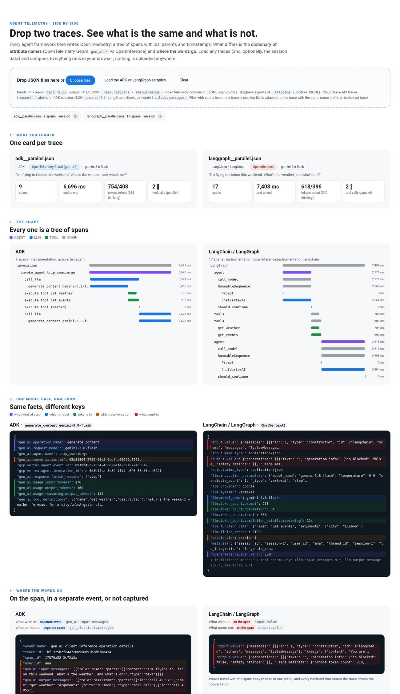
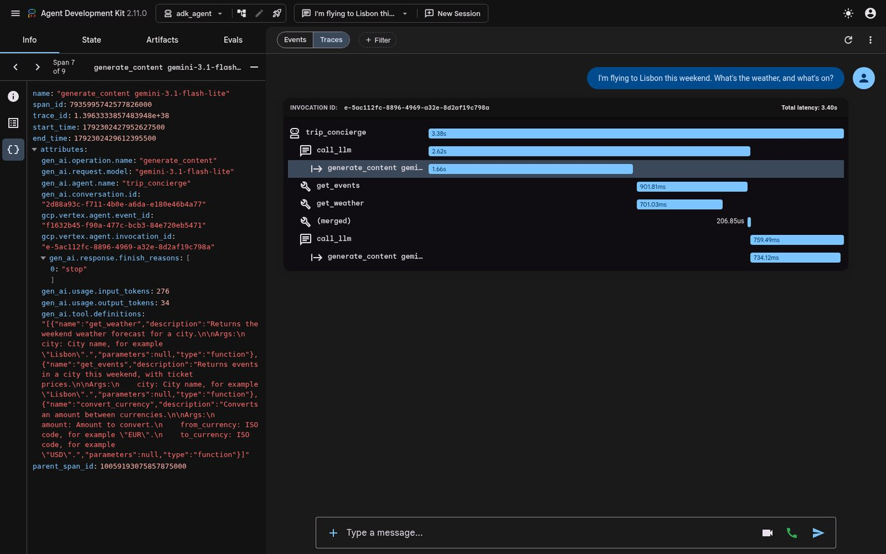
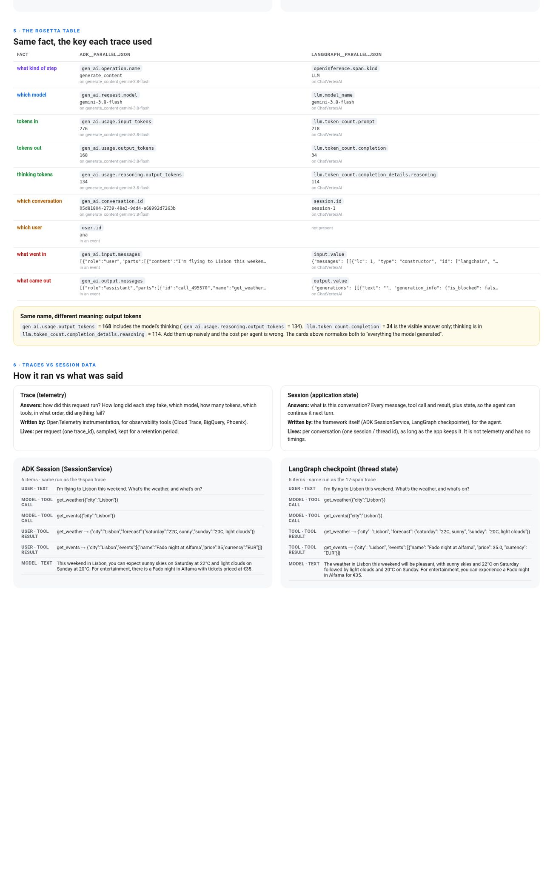

# Same agent, two telemetry dictionaries

> **Advent of Agents · Season 3 · Day 22 ("Observability & OpenTelemetry Tracing")**
> Companion repository and trace comparison app for [Advent of Agents](https://adventofagents.com/) Day 22: *"Can I get an immutable audit trail and latency trace of every tool call and model decision?"* See [`ARTICLE.md`](ARTICLE.md) for the full visual walkthrough.

One tiny trip-concierge agent, written twice (Google ADK and LangGraph), asked the same question on `gemini-3.8-flash`. Both write OpenTelemetry. This repo saves what each one writes as plain JSON, and ships a small browser app where you **drop any trace files** (yours or these) and see what is the same and what is different.

**The answer in one line:** both produce the same tree of spans (ids, parents, timestamps). The differences are the **names of the attributes** (`gen_ai.*` vs `openinference.*` / `llm.*`), **where the words go** (a separate, opt-in event vs on the span), and a few **traps** (the same "output tokens" name means different things).



## Run it

```bash
python -m venv .venv && source .venv/bin/activate
pip install -r requirements.txt

export GOOGLE_GENAI_USE_VERTEXAI=TRUE
export GOOGLE_CLOUD_PROJECT=<your-project>
export GOOGLE_CLOUD_LOCATION=global        # Gemini 3.x is served from the global endpoint

python capture.py adk                      # ADK, built-in OpenTelemetry
python capture.py langgraph                # LangGraph + OpenInference instrumentor
python capture.py adk-openinference        # bonus: the same ADK agent, OpenInference instrumentor
python capture.py adk --model claude-sonnet-5-5      # same harness, another provider (Claude)
python build_app.py                        # app/index.html with the two samples embedded
open app/index.html                        # or: python -m http.server -d app
```

Add `--question serial` to `capture.py` for the question where the second tool needs the first one's answer.

Each run writes `traces/<agent>__<question>.json` with three parts:
- `spans`: the trace (name, ids, parent, start/end, duration, attributes)
- `events`: OpenTelemetry log records (where ADK puts the words)
- `session`: the framework's own record of the conversation (ADK session events, LangGraph checkpoint)

Nothing is sent anywhere except the model calls: the exporters write to memory, and the app parses everything in your browser.

| File | What it is |
| :-- | :-- |
| `tools.py` | the three tools both agents share (plain Python, no framework) |
| `adk_agent/agent.py` | the ADK agent (also runs in `adk web .`) |
| `langgraph_agent.py` | the LangGraph agent, with a checkpointer so it has a session too |
| `capture.py` | runs one agent, saves trace, events and session as JSON |
| `genai_bridge.py` | 15-line OpenTelemetry `SpanProcessor` that bridges OpenInference attributes onto `gen_ai.*` so Agent Platform's Session view works for LangGraph |
| `app/template.html`, `build_app.py` | the drop-your-traces app (one static HTML file, no dependencies) |
| `ARTICLE.md` | the full Developer Community article with side-by-side diagrams and console walkthrough |

## The app

Drop JSON files on it, or pick a sample set: harness (ADK vs LangGraph), provider (Gemini vs Claude, per harness), or dictionary (ADK native vs ADK + OpenInference). It reads:
- this repo's `capture.py` output
- OTLP JSON (`resourceSpans`, `resourceLogs`), e.g. from an OpenTelemetry Collector file exporter
- OpenTelemetry console / JSONL span dumps
- BigQuery exports of Cloud Trace's `_AllSpans` table (JSON or JSONL), e.g. from an agent deployed to Agent Runtime
- Cloud Trace API traces
- ADK session JSON and LangGraph checkpoint state

For each trace it shows: a summary card (framework, dictionary, model, tokens, tool calls, parallel or not), the span tree, one model call as raw JSON with the same facts in the same color, where the words are, a Rosetta table across all loaded traces, and the session next to the trace.

## 1. The ADK agent and its telemetry

ADK has OpenTelemetry built in (`traces/adk__parallel.json`):

```
invocation
  invoke_agent trip_concierge
    call_llm
      generate_content gemini-3.8-flash     the model decides: two tools
    execute_tool get_weather                both tools start together
    execute_tool get_events
    execute_tool (merged)                   ADK bookkeeping for the parallel calls
    call_llm
      generate_content gemini-3.8-flash     the model answers
```

One model call: numbers, no words.

```json
{
  "gen_ai.operation.name": "generate_content",
  "gen_ai.request.model": "gemini-3.8-flash",
  "gen_ai.conversation.id": "05d81804-2739-48e3-9dd4-a68992d7263b",
  "gen_ai.usage.input_tokens": 276,
  "gen_ai.usage.output_tokens": 168,
  "gen_ai.usage.reasoning.output_tokens": 134
}
```

The same in ADK's dev UI (`adk web .`, then Traces, click a span, `{}` tab):



## 2. The LangGraph agent and its telemetry

LangGraph has no OpenTelemetry of its own; the OpenInference instrumentor adds it (`traces/langgraph__parallel.json`). Same story, more spans, because it traces every graph node and LangChain runnable. The same model call:

```json
{
  "openinference.span.kind": "LLM",
  "llm.model_name": "gemini-3.8-flash",
  "llm.token_count.prompt": 218,
  "llm.token_count.completion": 34,
  "llm.token_count.completion_details.reasoning": 114,
  "session.id": "session-1",
  "input.value": "{\"messages\": [[{\"lc\": 1, \"type\": \"constructor\", ...",
  "output.value": "{\"generations\": [[{\"text\": \"\", ..."
}
```

## 3. The differences

| fact | OpenTelemetry GenAI (ADK) | OpenInference (LangGraph) |
| :-- | :-- | :-- |
| what kind of step | `gen_ai.operation.name` = `generate_content` | `openinference.span.kind` = `LLM` |
| which model | `gen_ai.request.model` | `llm.model_name` |
| tokens in | `gen_ai.usage.input_tokens` | `llm.token_count.prompt` |
| tokens out | `gen_ai.usage.output_tokens` (**includes thinking**) | `llm.token_count.completion` (**visible answer only**) |
| thinking tokens | `gen_ai.usage.reasoning.output_tokens` | `llm.token_count.completion_details.reasoning` |
| which conversation | `gen_ai.conversation.id` | `session.id` |
| what was said | `gen_ai.input.messages` / `output.messages`, **in a separate event**, only with `OTEL_INSTRUMENTATION_GENAI_CAPTURE_MESSAGE_CONTENT=EVENT_ONLY` | `input.value` / `output.value`, **on the span**, on by default |

What the real data shows:
- **Same name, different meaning.** ADK's first model call reports 168 output tokens: 34 of answer plus 134 of thinking. LangGraph reports 34 output tokens and puts its 114 thinking tokens in a separate key. Add the two naively and your cost per agent is wrong; the app normalizes both.
- **Tokens in: 276 vs 218 for the same question.** ADK adds its own system text to the prompt ("You are an agent. Your internal name is…").
- **The framework does not decide the dictionary, the instrumentor does.** The same ADK agent with `GoogleADKInstrumentor()` writes OpenInference (`traces/adk-openinference__parallel.json`).

## 4. Same harness, different model (Gemini 3.8 Flash vs Claude Sonnet 5.5)

`python capture.py adk --model claude-sonnet-5-5` (and `langgraph`) runs the same agent on Claude: ADK's `Claude` class, LangChain's `ChatAnthropicVertex`. Claude must be enabled in the project's Model Garden (check with a one-line call before blaming the code: a 404 means "not enabled here").

**The harness decides the shape and the dictionary; the provider only changes values and optional keys.**

| | ADK: Gemini vs Claude | LangGraph: Gemini vs Claude |
| :-- | :-- | :-- |
| span tree | identical, 9 spans; only `generate_content <model>` changes | identical, 17 spans; `ChatVertexAI` becomes `ChatAnthropicVertex` |
| dictionary | `gen_ai.*` both times | OpenInference both times |
| provider on the span | **not declared at all**: `gen_ai.system` = `gcp.vertex.agent` (the harness, not the provider) | `llm.provider` = `google` vs `anthropicvertex` (free-form) |
| why it stopped | `["stop"]` both (ADK normalizes) | `STOP` vs `tool_use` (provider vocabulary leaks through) |
| tokens in, first call | 276 vs 851 | 218 vs 755 |
| thinking tokens | 134 vs 0 | 114 vs absent |
| keys only one reports | Claude adds `gen_ai.usage.cache_read.input_tokens`, `cache_creation.input_tokens` | Gemini adds `llm.system`, `llm.token_count.total`, `llm.function_call` |

Takeaways: group spend by provider from the **model name**, not from a provider attribute; never compare raw token counts across providers (tokenizers and tool-schema formatting differ about 3x here), compare cost; and normalize `finish_reason` values if you alert on them.

## 5. Traces vs session data

| | Trace (telemetry) | Session (application state) |
| :-- | :-- | :-- |
| answers | how did this request run? timing, model, tokens, tools, order, errors | what is this conversation? every message, tool call and result, plus state |
| written by | OpenTelemetry instrumentation, for observability tools | the framework (ADK `SessionService`, LangGraph checkpointer), for the agent |
| key | `trace_id` (one request) | session id / `thread_id` (one conversation) |
| has timings | yes | no |
| kept | sampled, for a retention period | as long as the app needs the conversation |

Same run, both records: ADK's session has 6 items (user text, two tool calls, two tool results, the answer) and so does LangGraph's checkpoint. Even here the frameworks differ: ADK records tool results with role `user`, LangGraph with role `tool`.



## 6. Why two dictionaries exist

| | OpenTelemetry GenAI conventions | OpenInference |
| :-- | :-- | :-- |
| who | the OpenTelemetry project (GenAI SIG), vendor neutral | Arize and the open-source community |
| built for | any observability backend: Cloud Trace, Datadog, Grafana | LLM debugging and evaluation tools: Phoenix, Arize, eval pipelines |
| style | `gen_ai.*`; numbers on spans, words as opt-in events (privacy first) | span kinds AGENT / LLM / TOOL / CHAIN / RETRIEVER; words on the span |
| status | marked Development in the spec, names still move | stable, instrumentors for many frameworks |

Same goal (observable agents without vendor lock-in), different audience (operations vs AI quality). Pick what your tools read, or keep both and normalize them at rest, for example with a SQL view in BigQuery.

## 7. Then, deployed

The same ADK agent deployed to Agent Runtime writes the same spans to Cloud Trace, stamped with the deployment (`cloud.resource_id = …/reasoningEngines/<id>`, `cloud.platform = gcp.agent_engine`). Export a trace from BigQuery (`_AllSpans`) and drop it in the app next to the local one. With `EVENT_ONLY`, the words land in the agent's own log (`reasoning_engine_stdout`), one entry per model call, labeled `event.name = gen_ai.client.inference.operation.details`, linked to the span by trace id and span id.

## 8. Making LangGraph light up in Agent Platform's Session view (`genai_bridge.py`)

When you deploy both agents to Agent Runtime (`LanggraphAgent(..., enable_tracing=True)` vs `AdkApp`), the Cloud console's **Traces › Session view** groups spans by `gen_ai.conversation.id` and sums `gen_ai.usage.input_tokens` + `gen_ai.usage.output_tokens` on `gen_ai.operation.name = "generate_content"` spans.

Because `LanggraphAgent` uses `openinference-instrumentation-langchain` out of the box, its spans carry `session.id` and `llm.token_count.*` instead, so **Session view** shows *"No sessions in the selected time range"* even though **Trace view** lists every trace.

You can fix this either **at rest** (with the BigQuery SQL view in Day 22 that `COALESCE`s both dictionaries) or **at the source** by calling `install_genai_bridge()` from [`genai_bridge.py`](genai_bridge.py) inside `LanggraphAgent`'s `model_builder`:

```python
from langchain_google_vertexai import ChatVertexAI
from vertexai.agent_engines import LanggraphAgent
from genai_bridge import install_genai_bridge

def bridged_model_builder(model_name: str, *, project: str, location: str, model_kwargs=None):
    install_genai_bridge()
    return ChatVertexAI(model_name=model_name, project=project, location="global", temperature=0, **(model_kwargs or {}))

agent = LanggraphAgent(
    model="gemini-3.8-flash",
    tools=[get_weather, get_events, convert_currency],
    model_builder=bridged_model_builder,
    runnable_kwargs={"prompt": INSTRUCTION},
    enable_tracing=True,
)
```

`GenAIBridgeSpanProcessor` keeps every OpenInference attribute intact and stamps `gen_ai.conversation.id`, `gen_ai.operation.name`, and `gen_ai.usage.*` before export, so Agent Platform's Session view populates sessions, model calls, tool calls, and token totals for LangGraph too.

## License

Copyright 2026 Google LLC. Licensed under the [Apache License, Version 2.0](LICENSE).

*This is not an officially supported Google product. This project is not eligible for the [Google Open Source Software Vulnerability Rewards Program](https://bughunters.google.com/open-source-security).*

